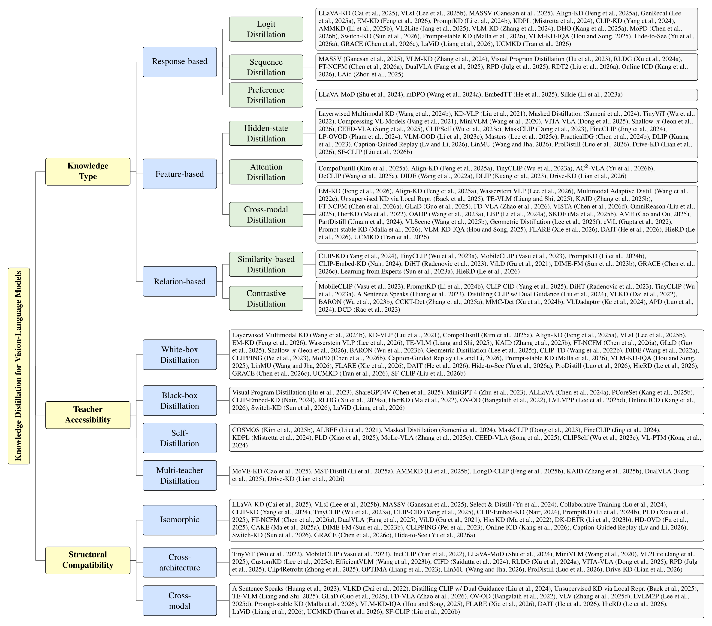
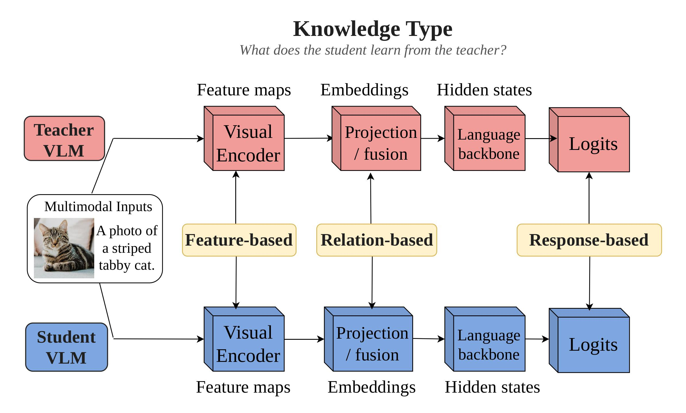
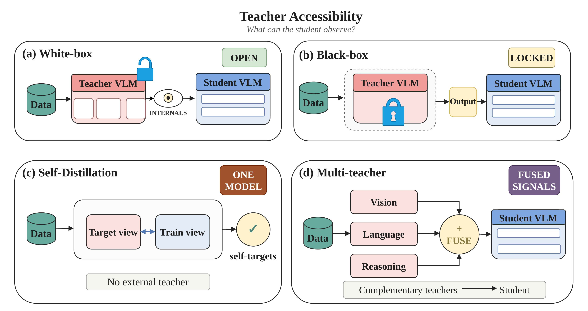
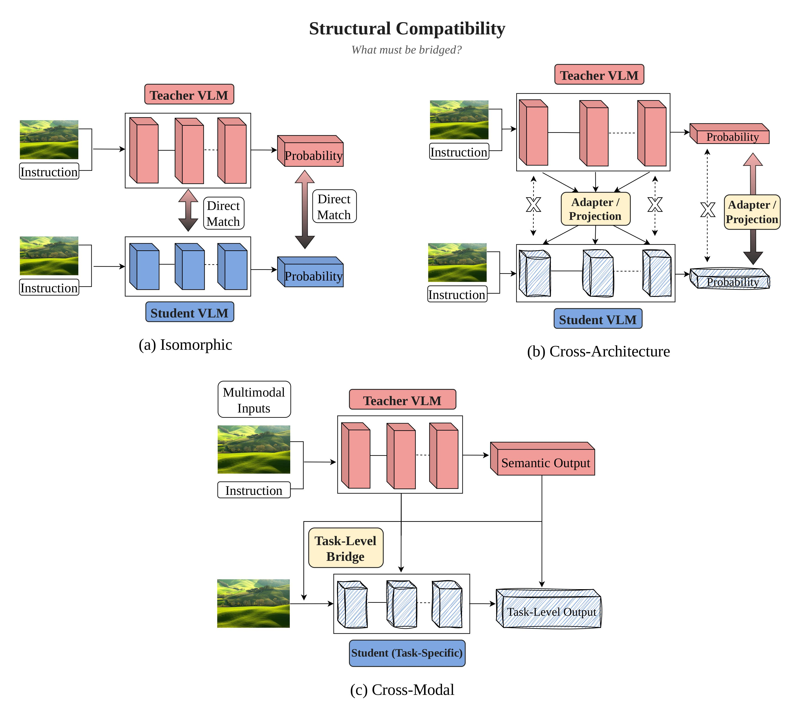

# A Survey on Knowledge Distillation of Vision-Language Models (EMNLP 2026)

<div align="center">

[](https://aclanthology.org/2026.findings-emnlp.180/)
[](https://2026.emnlp.org/)


<h3>Official repository of the EMNLP 2026 paper.</h3>

</div>

## 🔔 News

- **[17/11/2026]** Updated the survey with papers from EMNLP 2026 and ECCV 2026.
- **[02/10/2026]** Updated the survey with papers from CVPR 2026, ACL 2026, and ICML 2026.
- **[10/09/2026]** Camera-ready version for EMNLP 2026 is now available on the [ACL Anthology](https://aclanthology.org/2026.findings-emnlp.180/).
- **[21/08/2026]** 🎉 This survey has been accepted by the Conference on Empirical Methods in Natural Language Processing (EMNLP) 2026!

## 📖 Abstract

Vision-language models (VLMs) achieve strong multimodal performance but remain expensive to deploy. Knowledge distillation (KD) is an effective approach for compressing these models and transferring their capabilities to more efficient student models. While KD for large language models (LLMs) is already well surveyed, no existing work provides systematic coverage of KD for VLMs, where the addition of a visual modality introduces challenges that text-only distillation does not face.

This paper presents the first dedicated survey of knowledge distillation for vision-language models. We propose a unified taxonomy that organizes methods along three orthogonal views: **knowledge type**, **teacher accessibility**, and **structural compatibility**, and use it to organize methods across major VLM distillation settings. We also survey the associated datasets and evaluation protocols, identify open challenges, and outline directions for future research. This repository compiles the surveyed papers and is updated as new work appears.

**Key Contributions:**

*   **Survey:** The first comprehensive survey of knowledge distillation for vision-language models, covering methods, training objectives, datasets, and a comparison of performance profiles, empirical trends, and trade-offs.
*   **Taxonomy:** A multi-view taxonomy along orthogonal axes, so a method can be located and compared by the knowledge it transfers, the access it assumes, and the structural mismatch it bridges.
*   **Open problems:** Open challenges and future directions for knowledge distillation of vision-language models.

## 📊 Taxonomy

Below is the taxonomy summarizing the landscape of knowledge distillation research for VLMs:



This survey organizes VLM distillation methods along three **orthogonal** axes. Each axis is illustrated below, immediately before the corresponding paper sections.

| Axis | Question | Sections |
|---|---|---|
| **Knowledge Type** | What does the student learn from the teacher? | [I](#section-i-response-based-distillation) · [II](#section-ii-feature-based-distillation) · [III](#section-iii-relation-based-distillation) |
| **Teacher Accessibility** | What can the student observe about the teacher? | [IV](#section-iv-white-box-distillation) · [V](#section-v-black-box-distillation) · [VI](#section-vi-self-distillation) · [VII](#section-vii-multi-teacher-distillation) |
| **Structural Compatibility** | What must be bridged before distillation can proceed? | [VIII](#section-viii-structural-compatibility---isomorphic) · [IX](#section-ix-structural-compatibility---cross-architecture) · [X](#section-x-structural-compatibility---cross-modal) |

| Application | Section |
|---|---|
| Vision-Language-Action | [VLA](#knowledge-distillation-for-vision-language-action-models) |
| Vision-Language Embedding | [Embedding](#knowledge-distillation-for-vision-language-embedding-models) |
| Semantic Segmentation | [Segmentation](#vlm-knowledge-distillation-for-segmentation) |
| Open-Vocabulary Object Detection | [OVD](#vlm-knowledge-distillation-for-open-vocabulary-object-detection) |

## Knowledge Type

<p align="left">
  
</p>

| Branch | Section |
|---|---|
| Response-based Distillation | [Section I](#section-i-response-based-distillation) |
| Feature-based Distillation | [Section II](#section-ii-feature-based-distillation) |
| Relation-based Distillation | [Section III](#section-iii-relation-based-distillation) |

## Section I: Response-based Distillation

**Logit Distillation**

* LOREAL: Mitigating Low-Resolution Challenges in Vision-Language Models with Attribute-driven Prompt Self-Distillation [[Paper]](https://openaccess.thecvf.com/content/CVPR2026/html/Wang_LOREAL_Mitigating_Low-Resolution_Challenges_in_Vision-Language_Models_with_Attribute-driven_Prompt_CVPR_2026_paper.html) 
* Hyper-ICL: Attention Calibration with Hyperbolic Anchor Distillation for Multimodal In-Context Learning [[Paper]](https://proceedings.mlr.press/v306/alipour-talemi26a.html) 
* Video-OPD: Efficient Post-Training of Multimodal Large Language Models for Temporal Video Grounding via On-Policy Distillation [[Paper]](https://proceedings.mlr.press/v306/li26im.html) 
* Decomposed On-Policy Distillation for Vision-Language Reasoning: Steering Gradients for Visual Grounding [[Paper]](https://proceedings.mlr.press/v306/yoon26f.html) 
* MoPD: Mixture-of-Prompts Distillation for Vision-Language Models [[Paper]](https://doi.org/10.1109/TMM.2025.3645615) 
* Switch-KD: Visual-Switch Knowledge Distillation for Vision-Language Models [[Paper]](https://openaccess.thecvf.com/content/CVPR2026F/html/Sun_Switch-KD_Visual-Switch_Knowledge_Distillation_for_Vision-Language_Models_CVPRF_2026_paper.html) 
* Prompt-stable knowledge distillation of vision-language models for efficient waste classification in material recovery facilities [[Paper]](https://www.sciencedirect.com/science/article/pii/S0921344926001096) 
* Hide to See: Reasoning-prefix Masking for Visual-anchored Thinking in VLM Distillation [[Paper]](https://arxiv.org/abs/2605.11651) 
* Gated Relational Alignment via Confidence-based Distillation for Efficient VLMs [[Paper]](https://proceedings.mlr.press/v306/chen26am.html) 
* Large Language Model Teaches Visual Students: Cross-Modality Transfer of Fine-Grained Conceptual Knowledge [[Paper]](https://proceedings.mlr.press/v306/liang26ac.html) 
* Cross-Modal Knowledge Distillation without Paired Data: Theoretical Foundation and Algorithm [[Paper]](https://proceedings.mlr.press/v306/tran26e.html) 
* LLaVA-KD: A Framework of Distilling Multimodal Large Language Models [[Paper]](https://openaccess.thecvf.com/content/ICCV2025/papers/Cai_LLaVA-KD_A_Framework_of_Distilling_Multimodal_Large_Language_Models_ICCV_2025_paper.pdf) 
* VLsI: Verbalized Layers-to-Interactions from Large to Small Vision Language Models [[Paper]](https://arxiv.org/abs/2412.01822) 
* MASSV: Multimodal Adaptation and Self-Data Distillation for Speculative Decoding of Vision-Language Models [[Paper]](https://arxiv.org/abs/2505.10526) 
* GenRecal: Generation after Recalibration from Large to Small Vision-Language Models [[Paper]](https://arxiv.org/abs/2506.15681) 
* EM-KD: Distilling Efficient Multimodal Large Language Model with Unbalanced Vision Tokens [[Paper]](https://arxiv.org/abs/2511.21106) 
* AMMKD: Adaptive Multimodal Multi-Teacher Distillation for Lightweight Vision-Language Models [[Paper]](https://arxiv.org/abs/2509.00039) 
* VL2Lite: Task-Specific Knowledge Distillation from Large Vision-Language Models to Lightweight Networks [[Paper]](https://openaccess.thecvf.com/content/CVPR2025/papers/Jang_VL2Lite_Task-Specific_Knowledge_Distillation_from_Large_Vision-Language_Models_to_Lightweight_CVPR_2025_paper.pdf) 
* DHO: Simple yet Effective Semi-supervised Knowledge Distillation from Vision-Language Models via Dual-Head Optimization [[Paper]](https://arxiv.org/abs/2505.07675) 
* Visual-Language Model Knowledge Distillation Method for Image Quality Assessment [[Paper]](https://arxiv.org/abs/2507.15680) 
* Align-KD: Distilling Cross-Modal Alignment Knowledge for Mobile Vision-Language Large Model Enhancement [[Paper]](https://openaccess.thecvf.com/content/CVPR2025/papers/Feng_Align-KD_Distilling_Cross-Modal_Alignment_Knowledge_for_Mobile_Vision-Language_Large_Model_CVPR_2025_paper.pdf) 
* PromptKD: Unsupervised Prompt Distillation for Vision-Language Models [[Paper]](https://openaccess.thecvf.com/content/CVPR2024/papers/Li_PromptKD_Unsupervised_Prompt_Distillation_for_Vision-Language_Models_CVPR_2024_paper.pdf) 
* Improving Zero-Shot Generalization of Learned Prompts via Unsupervised Knowledge Distillation [[Paper]](https://arxiv.org/abs/2407.03056) 
* VLM-KD: Knowledge Distillation from VLM for Long-Tail Visual Recognition [[Paper]](https://arxiv.org/abs/2408.16930) 
* CLIP-KD: An Empirical Study of CLIP Model Distillation [[Paper]](https://arxiv.org/abs/2307.12732) 

**Sequence Distillation**

* Beyond Weak Supervision: MLLMs-Guided Graded Knowledge Distillation for Unsupervised Camouflaged Object Detection [[Paper]](https://openaccess.thecvf.com/content/CVPR2026/html/Chen_Beyond_Weak_Supervision_MLLMs-Guided_Graded_Knowledge_Distillation_for_Unsupervised_Camouflaged_CVPR_2026_paper.html) 
* LEAF: Towards Lightweight Explainable Hateful Video Detection via Self-Grounding CoT Guided Stage-Wise Distillation [[Paper]](https://aclanthology.org/2026.findings-acl.604/) 
* Resource-Limited Joint Multimodal Sentiment Reasoning and Classification via Chain-of-Thought Enhancement and Distillation [[Paper]](https://aclanthology.org/2026.findings-acl.784/) 
* Beyond Next-Token Alignment: Distilling Multimodal Large Language Models via Token Interactions [[Paper]](https://proceedings.mlr.press/v306/chen26gr.html) 
* Zooming without Zooming: Region-to-Image Distillation for Fine-Grained Multimodal Perception [[Paper]](https://proceedings.mlr.press/v306/wei26j.html) 
* Distilling Neuro-Symbolic Programs into 3D Multi-modal LLMs [[Paper]](https://proceedings.mlr.press/v306/mo26c.html) 
* RDT2: Exploring the Scaling Limit of UMI Data Towards Zero-Shot Cross-Embodiment Generalization [[Paper]](https://arxiv.org/abs/2602.03310) 
* MASSV: Multimodal Adaptation and Self-Data Distillation for Speculative Decoding of Vision-Language Models [[Paper]](https://arxiv.org/abs/2505.10526) 
* FT-NCFM: An Influence-Aware Data Distillation Framework for Efficient VLA Models [[Paper]](https://arxiv.org/abs/2511.16233) 
* DualVLA: Building a Generalizable Embodied Agent via Partial Decoupling of Reasoning and Action [[Paper]](https://arxiv.org/abs/2511.22134) 
* Refined Policy Distillation: From VLA Generalists to RL Experts [[Paper]](https://arxiv.org/abs/2503.05833) 
* Online In-Context Distillation for Low-Resource Vision Language Models [[Paper]](https://arxiv.org/abs/2510.18117) 
* Towards Long-window Anchoring in Vision-Language Model Distillation [[Paper]](https://arxiv.org/abs/2512.21576) 
* VLM-KD: Knowledge Distillation from VLM for Long-Tail Visual Recognition [[Paper]](https://arxiv.org/abs/2408.16930) 
* Visual Program Distillation: Distilling Tools and Programmatic Reasoning into Vision-Language Models [[Paper]](https://arxiv.org/abs/2312.03052) 
* RLDG: Robotic Generalist Policy Distillation via Reinforcement Learning [[Paper]](https://arxiv.org/abs/2412.09858) 

**Preference Distillation**

* Embedding the Teacher: Distilling vLLM Preferences for Scalable Image Retrieval [[Paper]](https://arxiv.org/abs/2510.12014) 
* LLaVA-MoD: Making LLaVA Tiny via MoE Knowledge Distillation [[Paper]](https://arxiv.org/abs/2408.15881) 
* mDPO: Conditional Preference Optimization for Multimodal Large Language Models [[Paper]](https://aclanthology.org/2024.emnlp-main.460/) 
* Silkie: Preference Distillation for Large Visual Language Models [[Paper]](https://arxiv.org/abs/2312.10665) 

## Section II: Feature-based Distillation

**Hidden-state Distillation**

* Uncertainty-Aware Knowledge Distillation for Multimodal Large Language Models [[Paper]](https://openaccess.thecvf.com/content/CVPR2026/html/Sun_Uncertainty-Aware_Knowledge_Distillation_for_Multimodal_Large_Language_Models_CVPR_2026_paper.html) 
* PseudoGD: Enhancing Spatial Reasoning in Vision-Language Models through Pseudo Geometric Knowledge Distillation [[Paper]](https://aclanthology.org/2026.findings-acl.1539/) 
* DREAM-S: Speculative Decoding with Searchable Drafting and Target-Aware Refinement for Multimodal Generation [[Paper]](https://aclanthology.org/2026.acl-long.2177/) 
* CritiqueDriveVLM: From Verifier-Guided Reinforcement Learning to Latent Thought Distillation for Autonomous Driving [[Paper]](https://arxiv.org/abs/2607.04179) 
* CROSS: Cascaded Distillation and Dual-Constraint Grounding for Remote Sensing Referring Segmentation [[Paper]](https://arxiv.org/abs/2608.03147) 
* Hyper-ICL: Attention Calibration with Hyperbolic Anchor Distillation for Multimodal In-Context Learning [[Paper]](https://proceedings.mlr.press/v306/alipour-talemi26a.html) 
* MLLMCLIP: Feature-Level Distillation of MLLM for Robust Vision-Language Representations [[Paper]](https://aclanthology.org/2026.emnlp-main.1187/) 
* DGS-Net: Distillation-Guided Gradient Surgery for CLIP Fine-Tuning in AI-Generated Image Detection [[Paper]](https://proceedings.mlr.press/v306/yan26h.html) 
* Shallow-π: Knowledge Distillation for Flow-based VLAs [[Paper]](https://arxiv.org/abs/2601.20262) 
* LinMU: Multimodal Understanding Made Linear [[Paper]](https://arxiv.org/abs/2601.01322) 
* Prodistill: A Progressive Prompting Framework for Fine-Grained VLM Distillation [[Paper]](https://ieeexplore.ieee.org/document/11461281/) 
* Drive-KD: Multi-Teacher Distillation for VLMs in Autonomous Driving [[Paper]](https://arxiv.org/abs/2601.21288) 
* SF-CLIP: CLIP-based Arbitrary Style Image Retrieval with Style and Fine-Grained Semantic Enhancement [[Paper]](https://doi.org/10.1109/ICASSP55912.2026.11461615) 
* VITA-VLA: Efficiently Teaching Vision-Language Models to Act via Action Expert Distillation [[Paper]](https://arxiv.org/abs/2510.09607) 
* CEED-VLA: Consistency Vision-Language-Action Model with Early-Exit Decoding [[Paper]](https://arxiv.org/abs/2506.13725) 
* Masking Teacher and Reinforcing Student for Distilling Vision-Language Models [[Paper]](https://openaccess.thecvf.com/content/CVPR2026/html/Lee_Masking_Teacher_and_Reinforcing_Student_for_Distilling_Vision-Language_Models_CVPR_2026_paper.html) 
* Layerwised Multimodal Knowledge Distillation for Vision-Language Pretrained Model [[Paper]](https://www.sciencedirect.com/science/article/abs/pii/S0893608024001965) 
* Building Vision-Language Models on Solid Foundations with Masked Distillation [[Paper]](https://openaccess.thecvf.com/content/CVPR2024/papers/Sameni_Building_Vision-Language_Models_on_Solid_Foundations_with_Masked_Distillation_CVPR_2024_paper.pdf) 
* FineCLIP: Self-distilled Region-based CLIP for Better Fine-grained Understanding [[Paper]](https://proceedings.neurips.cc/paper_files/paper/2024/file/3122aaa22b2fe83f9cead1a696f65ceb-Paper-Conference.pdf) 
* LP-OVOD: Open-Vocabulary Object Detection by Linear Probing [[Paper]](https://arxiv.org/abs/2310.17109) 
* PracticalDG: Perturbation Distillation on Vision-Language Models for Hybrid Domain Generalization [[Paper]](https://arxiv.org/abs/2404.09011) 
* CLIPSelf: Vision Transformer Distills Itself for Open-Vocabulary Dense Prediction [[Paper]](https://arxiv.org/abs/2310.01403) 
* MaskCLIP: Masked Self-Distillation Advances Contrastive Language-Image Pretraining [[Paper]](https://openaccess.thecvf.com/content/CVPR2023/papers/Dong_MaskCLIP_Masked_Self-Distillation_Advances_Contrastive_Language-Image_Pretraining_CVPR_2023_paper.pdf) 
* Distilling Large Vision-Language Model with Out-of-Distribution Generalizability [[Paper]](https://openaccess.thecvf.com/content/ICCV2023/papers/Li_Distilling_Large_Vision-Language_Model_with_Out-of-Distribution_Generalizability_ICCV_2023_paper.pdf) 
* DLIP: Distilling Language-Image Pre-training [[Paper]](https://arxiv.org/abs/2308.12956) 
* KD-VLP: Improving End-to-End Vision-and-Language Pretraining with Object Knowledge Distillation [[Paper]](https://arxiv.org/abs/2109.10504) 
* TinyViT: Fast Pretraining Distillation for Small Vision Transformers [[Paper]](https://arxiv.org/abs/2207.10666) 
* Compressing Visual-Linguistic Model via Knowledge Distillation [[Paper]](https://arxiv.org/abs/2104.02096) 
* MiniVLM: A Smaller and Faster Vision-Language Model [[Paper]](https://arxiv.org/abs/2012.06946) 

**Attention Distillation**

* Token-level Response-visual Attention Guidance for Multimodal LLMs Knowledge Distillation [[Paper]](https://arxiv.org/abs/2607.02593) 
* Hyper-ICL: Attention Calibration with Hyperbolic Anchor Distillation for Multimodal In-Context Learning [[Paper]](https://proceedings.mlr.press/v306/alipour-talemi26a.html) 
* Beyond Next-Token Alignment: Distilling Multimodal Large Language Models via Token Interactions [[Paper]](https://proceedings.mlr.press/v306/chen26gr.html) 
* AC^2-VLA: Action-Context-Aware Adaptive Computation in Vision-Language-Action Models for Efficient Robotic Manipulation [[Paper]](https://arxiv.org/abs/2601.19634) 
* Drive-KD: Multi-Teacher Distillation for VLMs in Autonomous Driving [[Paper]](https://arxiv.org/abs/2601.21288) 
* CompoDistill: Attention Distillation for Compositional Reasoning in Multimodal LLMs [[Paper]](https://arxiv.org/abs/2510.12184) 
* DeCLIP: Decoupled Learning for Open-Vocabulary Dense Perception [[Paper]](https://arxiv.org/abs/2505.04410) 
* Align-KD: Distilling Cross-Modal Alignment Knowledge for Mobile Vision-Language Large Model Enhancement [[Paper]](https://openaccess.thecvf.com/content/CVPR2025/papers/Feng_Align-KD_Distilling_Cross-Modal_Alignment_Knowledge_for_Mobile_Vision-Language_Large_Model_CVPR_2025_paper.pdf) 
* TinyCLIP: CLIP Distillation via Affinity Mimicking and Weight Inheritance [[Paper]](https://arxiv.org/abs/2309.12314) 
* DLIP: Distilling Language-Image Pre-training [[Paper]](https://arxiv.org/abs/2308.12956) 
* DIDE: Distilled Dual-Encoder Model for Vision-Language Understanding [[Paper]](https://doi.org/10.18653/v1/2022.emnlp-main.608) 

**Cross-modal Feature Distillation**

* Prompt-Anchored Vision-Text Distillation for Lifelong Person Re-identification [[Paper]](https://openaccess.thecvf.com/content/CVPR2026/html/Wen_Prompt-Anchored_Vision-Text_Distillation_for_Lifelong_Person_Re-identification_CVPR_2026_paper.html) 
* NoOVD: Novel Category Discovery and Embedding for Open-Vocabulary Object Detection [[Paper]](https://openaccess.thecvf.com/content/CVPR2026/html/Zhang_NoOVD_Novel_Category_Discovery_and_Embedding_for_Open-Vocabulary_Object_Detection_CVPR_2026_paper.html) 
* Reconstructing CLIP for Open-Vocabulary Dense Perception [[Paper]](https://openaccess.thecvf.com/content/CVPR2026/html/Liu_Reconstructing_CLIP_for_Open-Vocabulary_Dense_Perception_CVPR_2026_paper.html) 
* Thermal-Det: Language-Guided Cross-Modal Distillation for Open-Vocabulary Thermal Object Detection [[Paper]](https://openaccess.thecvf.com/content/CVPR2026/html/Ranasinghe_Thermal-Det_Language-Guided_Cross-Modal_Distillation_for_Open-Vocabulary_Thermal_Object_Detection_CVPR_2026_paper.html) 
* BEVLM: Distilling Semantic Knowledge from LLMs into Bird's-Eye View Representations [[Paper]](https://arxiv.org/abs/2603.06576) 
* Open-Vocabulary 3D Object Detection with Co-Distillation Discovery and Dual Guidance Robust Training [[Paper]](https://arxiv.org/abs/2608.19973) 
* Object-level Semantic and Spatial Distillation for Open Vocabulary Detection [[Paper]](https://proceedings.mlr.press/v306/li26hp.html) 
* Rh-3DGS: Robust Open-Vocabulary Scene Understanding via Riemannian Huber Distillation and Manifold-Aware Sampling [[Paper]](https://proceedings.mlr.press/v306/zhao26s.html) 
* NanoVDR: Distilling a 2B Vision-Language Retriever into a 70M Text-Only Encoder for Visual Document Retrieval [[Paper]](https://aclanthology.org/2026.emnlp-main.71/) 
* Beyond Caption Loss: Generative Distillation for Modality Alignment in Vision-Language Models [[Paper]](https://aclanthology.org/2026.findings-emnlp.1876/) 
* FD-VLA: Force-Distilled Vision-Language-Action Model for Contact-Rich Manipulation [[Paper]](https://arxiv.org/abs/2602.02142) 
* VISTA: Enhancing Visual Conditioning via Track-Following Preference Optimization in Vision-Language-Action Models [[Paper]](https://arxiv.org/abs/2602.05049) 
* Prompt-stable knowledge distillation of vision-language models for efficient waste classification in material recovery facilities [[Paper]](https://www.sciencedirect.com/science/article/pii/S0921344926001096) 
* FLARE: Learning Future-Aware Latent Representations from Vision-Language Models for Autonomous Driving [[Paper]](https://arxiv.org/abs/2601.05611) 
* DAIT: Distillation from Vision-Language Models to Lightweight Classifiers with Adaptive Intermediate Teacher Transfer [[Paper]](https://arxiv.org/abs/2603.15166) 
* HieRD: Hierarchical Relational Distillation for Vision-Language Embedding Models [[Paper]](https://proceedings.mlr.press/v306/le26b.html) 
* Cross-Modal Knowledge Distillation without Paired Data: Theoretical Foundation and Algorithm [[Paper]](https://proceedings.mlr.press/v306/tran26e.html) 
* EM-KD: Distilling Efficient Multimodal Large Language Model with Unbalanced Vision Tokens [[Paper]](https://arxiv.org/abs/2511.21106) 
* Modality-specific Knowledge Distillation with Wasserstein Distance Minimization for Vision-Language Pretrained Models [[Paper]](https://ieeexplore.ieee.org/document/11178237) 
* Unsupervised Knowledge Distillation via Local Representations for Vision-Language Models [[Paper]](https://ieeexplore.ieee.org/document/11048580) 
* TE-VLM: Transfer Entropy for Vision Language Model Distillation [[Paper]](https://doi.org/10.36227/techrxiv.176521376.67429287/v1) 
* KAID: Knowledge-Aware Interactive Distillation for Vision-Language Models [[Paper]](https://doi.org/10.1145/3746027.3755008) 
* FT-NCFM: An Influence-Aware Data Distillation Framework for Efficient VLA Models [[Paper]](https://arxiv.org/abs/2511.16233) 
* GLaD: Geometric Latent Distillation for Vision-Language-Action Models [[Paper]](https://arxiv.org/abs/2512.09619) 
* OmniReason: A Temporal-Guided Vision-Language-Action Framework for Autonomous Driving [[Paper]](https://arxiv.org/abs/2509.00789v1) 
* AME: Aligned Manifold Entropy for Robust Vision-Language Distillation [[Paper]](https://arxiv.org/abs/2508.08644) 
* VLScene: Vision-language guidance distillation for camera-based 3D semantic scene completion [[Paper]](https://arxiv.org/abs/2503.06219) 
* 3D-aware vision-language models fine-tuning with geometric distillation [[Paper]](https://arxiv.org/abs/2506.09883) 
* Visual-Language Model Knowledge Distillation Method for Image Quality Assessment [[Paper]](https://arxiv.org/abs/2507.15680) 
* Align-KD: Distilling Cross-Modal Alignment Knowledge for Mobile Vision-Language Large Model Enhancement [[Paper]](https://openaccess.thecvf.com/content/CVPR2025/papers/Feng_Align-KD_Distilling_Cross-Modal_Alignment_Knowledge_for_Mobile_Vision-Language_Large_Model_CVPR_2025_paper.pdf) 
* Learning Background Prompts to Discover Implicit Knowledge for Open Vocabulary Object Detection [[Paper]](https://arxiv.org/abs/2406.00510) 
* SKDF: A Simple Knowledge Distillation Framework for Distilling Open-Vocabulary Knowledge to Open-World Object Detector [[Paper]](https://arxiv.org/abs/2312.08653) 
* PartDistill: 3D Shape Part Segmentation by Vision-Language Model Distillation [[Paper]](https://arxiv.org/abs/2312.04016) 
* Object-Aware Distillation Pyramid for Open-Vocabulary Object Detection [[Paper]](https://arxiv.org/abs/2303.05892) 
* Multimodal Adaptive Distillation for Leveraging Unimodal Encoders for Vision-Language Tasks [[Paper]](https://arxiv.org/abs/2204.10496) 
* Open-Vocabulary One-Stage Detection with Hierarchical Visual-Language Knowledge Distillation [[Paper]](https://arxiv.org/abs/2203.10593) 
* cViL: Cross-Lingual Training of Vision-Language Models using Knowledge Distillation [[Paper]](https://doi.org/10.1109/ICPR56361.2022.9956259) 

## Section III: Relation-based Distillation

**Similarity-based Distillation**

* SigLino: Efficient Multi-Teacher Distillation for Agglomerative Vision Foundation Models [[Paper]](https://openaccess.thecvf.com/content/CVPR2026/html/Chaybouti_SigLino_Efficient_Multi-Teacher_Distillation_for_Agglomerative_Vision_Foundation_Models_CVPR_2026_paper.html) 
* MLLMCLIP: Feature-Level Distillation of MLLM for Robust Vision-Language Representations [[Paper]](https://aclanthology.org/2026.emnlp-main.1187/) 
* Gated Relational Alignment via Confidence-based Distillation for Efficient VLMs [[Paper]](https://proceedings.mlr.press/v306/chen26am.html) 
* HieRD: Hierarchical Relational Distillation for Vision-Language Embedding Models [[Paper]](https://proceedings.mlr.press/v306/le26b.html) 
* MobileCLIP: Fast Image-Text Models through Multi-Modal Reinforced Training [[Paper]](https://arxiv.org/abs/2311.17049) 
* PromptKD: Unsupervised Prompt Distillation for Vision-Language Models [[Paper]](https://openaccess.thecvf.com/content/CVPR2024/papers/Li_PromptKD_Unsupervised_Prompt_Distillation_for_Vision-Language_Models_CVPR_2024_paper.pdf) 
* CLIP-Embed-KD: Computationally Efficient Knowledge Distillation Using Embeddings as Teachers [[Paper]](https://arxiv.org/abs/2404.06170) 
* CLIP-KD: An Empirical Study of CLIP Model Distillation [[Paper]](https://arxiv.org/abs/2307.12732) 
* TinyCLIP: CLIP Distillation via Affinity Mimicking and Weight Inheritance [[Paper]](https://arxiv.org/abs/2309.12314) 
* Filtering, Distillation, and Hard Negatives for Vision-Language Pre-Training [[Paper]](https://arxiv.org/abs/2301.02280) 
* DIME-FM: Distilling Multimodal and Efficient Foundation Models [[Paper]](https://arxiv.org/abs/2303.18232) 
* Learning From Expert: Vision-Language Knowledge Distillation for Unsupervised Cross-Modal Hashing Retrieval [[Paper]](https://doi.org/10.1145/3591106.3592242) 
* Open-Vocabulary Object Detection via Vision and Language Knowledge Distillation [[Paper]](https://arxiv.org/abs/2104.13921) 

**Contrastive Distillation**

* CLIP-CID: Efficient CLIP Distillation via Cluster-Instance Discrimination [[Paper]](https://doi.org/10.1609/aaai.v39i20.35505) 
* Cyclic Contrastive Knowledge Transfer for Open-Vocabulary Object Detection [[Paper]](https://arxiv.org/abs/2503.11005) 
* MobileCLIP: Fast Image-Text Models through Multi-Modal Reinforced Training [[Paper]](https://arxiv.org/abs/2311.17049) 
* PromptKD: Unsupervised Prompt Distillation for Vision-Language Models [[Paper]](https://openaccess.thecvf.com/content/CVPR2024/papers/Li_PromptKD_Unsupervised_Prompt_Distillation_for_Vision-Language_Models_CVPR_2024_paper.pdf) 
* Distilling CLIP with Dual Guidance for Learning Discriminative Human Body Shape Representation [[Paper]](https://openaccess.thecvf.com/content/CVPR2024/papers/Liu_Distilling_CLIP_with_Dual_Guidance_for_Learning_Discriminative_Human_Body_CVPR_2024_paper.pdf) 
* VLDadaptor: Domain Adaptive Object Detection with Vision-Language Model Distillation [[Paper]](https://ieeexplore.ieee.org/document/10669066) 
* Adversarial prompt distillation for vision-language models [[Paper]](https://arxiv.org/abs/2411.15244) 
* Filtering, Distillation, and Hard Negatives for Vision-Language Pre-Training [[Paper]](https://arxiv.org/abs/2301.02280) 
* TinyCLIP: CLIP Distillation via Affinity Mimicking and Weight Inheritance [[Paper]](https://arxiv.org/abs/2309.12314) 
* A Sentence Speaks a Thousand Images: Domain Generalization through Distilling CLIP with Language Guidance [[Paper]](https://arxiv.org/abs/2309.12530) 
* Aligning Bag of Regions for Open-Vocabulary Object Detection [[Paper]](https://arxiv.org/abs/2302.13996) 
* Exploring Multi-Modal Contextual Knowledge for Open-Vocabulary Object Detection [[Paper]](https://arxiv.org/abs/2308.15846) 
* Dynamic contrastive distillation for image-text retrieval [[Paper]](https://arxiv.org/abs/2207.01426) 
* Enabling Multimodal Generation on CLIP via Vision-Language Knowledge Distillation [[Paper]](https://arxiv.org/abs/2203.06386) 

## Teacher Accessibility

<p align="left">
  
</p>

| Regime | Section |
|---|---|
| White-box Distillation  | [Section IV](#section-iv-white-box-distillation) |
| Black-box Distillation  | [Section V](#section-v-black-box-distillation) |
| Self-Distillation | [Section VI](#section-vi-self-distillation) |
| Multi-teacher Distillation  | [Section VII](#section-vii-multi-teacher-distillation) |

## Section IV: White-box Distillation
* Uncertainty-Aware Knowledge Distillation for Multimodal Large Language Models [[Paper]](https://openaccess.thecvf.com/content/CVPR2026/html/Sun_Uncertainty-Aware_Knowledge_Distillation_for_Multimodal_Large_Language_Models_CVPR_2026_paper.html) 
* SigLino: Efficient Multi-Teacher Distillation for Agglomerative Vision Foundation Models [[Paper]](https://openaccess.thecvf.com/content/CVPR2026/html/Chaybouti_SigLino_Efficient_Multi-Teacher_Distillation_for_Agglomerative_Vision_Foundation_Models_CVPR_2026_paper.html) 
* PseudoGD: Enhancing Spatial Reasoning in Vision-Language Models through Pseudo Geometric Knowledge Distillation [[Paper]](https://aclanthology.org/2026.findings-acl.1539/) 
* DREAM-S: Speculative Decoding with Searchable Drafting and Target-Aware Refinement for Multimodal Generation [[Paper]](https://aclanthology.org/2026.acl-long.2177/) 
* NoOVD: Novel Category Discovery and Embedding for Open-Vocabulary Object Detection [[Paper]](https://openaccess.thecvf.com/content/CVPR2026/html/Zhang_NoOVD_Novel_Category_Discovery_and_Embedding_for_Open-Vocabulary_Object_Detection_CVPR_2026_paper.html) 
* Token-level Response-visual Attention Guidance for Multimodal LLMs Knowledge Distillation [[Paper]](https://arxiv.org/abs/2607.02593) 
* CritiqueDriveVLM: From Verifier-Guided Reinforcement Learning to Latent Thought Distillation for Autonomous Driving [[Paper]](https://arxiv.org/abs/2607.04179) 
* CROSS: Cascaded Distillation and Dual-Constraint Grounding for Remote Sensing Referring Segmentation [[Paper]](https://arxiv.org/abs/2608.03147) 
* Hyper-ICL: Attention Calibration with Hyperbolic Anchor Distillation for Multimodal In-Context Learning [[Paper]](https://proceedings.mlr.press/v306/alipour-talemi26a.html) 
* Beyond Next-Token Alignment: Distilling Multimodal Large Language Models via Token Interactions [[Paper]](https://proceedings.mlr.press/v306/chen26gr.html) 
* Video-OPD: Efficient Post-Training of Multimodal Large Language Models for Temporal Video Grounding via On-Policy Distillation [[Paper]](https://proceedings.mlr.press/v306/li26im.html) 
* Decomposed On-Policy Distillation for Vision-Language Reasoning: Steering Gradients for Visual Grounding [[Paper]](https://proceedings.mlr.press/v306/yoon26f.html) 
* MLLMCLIP: Feature-Level Distillation of MLLM for Robust Vision-Language Representations [[Paper]](https://aclanthology.org/2026.emnlp-main.1187/) 
* DGS-Net: Distillation-Guided Gradient Surgery for CLIP Fine-Tuning in AI-Generated Image Detection [[Paper]](https://proceedings.mlr.press/v306/yan26h.html) 
* Shallow-π: Knowledge Distillation for Flow-based VLAs [[Paper]](https://arxiv.org/abs/2601.20262) 
* MoPD: Mixture-of-Prompts Distillation for Vision-Language Models [[Paper]](https://doi.org/10.1109/TMM.2025.3645615) 
* Prompt-stable knowledge distillation of vision-language models for efficient waste classification in material recovery facilities [[Paper]](https://www.sciencedirect.com/science/article/pii/S0921344926001096) 
* LinMU: Multimodal Understanding Made Linear [[Paper]](https://arxiv.org/abs/2601.01322) 
* FLARE: Learning Future-Aware Latent Representations from Vision-Language Models for Autonomous Driving [[Paper]](https://arxiv.org/abs/2601.05611) 
* DAIT: Distillation from Vision-Language Models to Lightweight Classifiers with Adaptive Intermediate Teacher Transfer [[Paper]](https://arxiv.org/abs/2603.15166) 
* Hide to See: Reasoning-prefix Masking for Visual-anchored Thinking in VLM Distillation [[Paper]](https://arxiv.org/abs/2605.11651) 
* Prodistill: A Progressive Prompting Framework for Fine-Grained VLM Distillation [[Paper]](https://ieeexplore.ieee.org/document/11461281/) 
* HieRD: Hierarchical Relational Distillation for Vision-Language Embedding Models [[Paper]](https://proceedings.mlr.press/v306/le26b.html) 
* Gated Relational Alignment via Confidence-based Distillation for Efficient VLMs [[Paper]](https://proceedings.mlr.press/v306/chen26am.html) 
* Cross-Modal Knowledge Distillation without Paired Data: Theoretical Foundation and Algorithm [[Paper]](https://proceedings.mlr.press/v306/tran26e.html) 
* SF-CLIP: CLIP-based Arbitrary Style Image Retrieval with Style and Fine-Grained Semantic Enhancement [[Paper]](https://doi.org/10.1109/ICASSP55912.2026.11461615) 
* CompoDistill: Attention Distillation for Compositional Reasoning in Multimodal LLMs [[Paper]](https://arxiv.org/abs/2510.12184) 
* VLsI: Verbalized Layers-to-Interactions from Large to Small Vision Language Models [[Paper]](https://arxiv.org/abs/2412.01822) 
* EM-KD: Distilling Efficient Multimodal Large Language Model with Unbalanced Vision Tokens [[Paper]](https://arxiv.org/abs/2511.21106) 
* Modality-specific Knowledge Distillation with Wasserstein Distance Minimization for Vision-Language Pretrained Models [[Paper]](https://ieeexplore.ieee.org/document/11178237) 
* TE-VLM: Transfer Entropy for Vision Language Model Distillation [[Paper]](https://doi.org/10.36227/techrxiv.176521376.67429287/v1) 
* KAID: Knowledge-Aware Interactive Distillation for Vision-Language Models [[Paper]](https://doi.org/10.1145/3746027.3755008) 
* FT-NCFM: An Influence-Aware Data Distillation Framework for Efficient VLA Models [[Paper]](https://arxiv.org/abs/2511.16233) 
* GLaD: Geometric Latent Distillation for Vision-Language-Action Models [[Paper]](https://arxiv.org/abs/2512.09619) 
* 3D-aware vision-language models fine-tuning with geometric distillation [[Paper]](https://arxiv.org/abs/2506.09883) 
* Visual-Language Model Knowledge Distillation Method for Image Quality Assessment [[Paper]](https://arxiv.org/abs/2507.15680) 
* Layerwised Multimodal Knowledge Distillation for Vision-Language Pretrained Model [[Paper]](https://www.sciencedirect.com/science/article/abs/pii/S0893608024001965) 
* Align-KD: Distilling Cross-Modal Alignment Knowledge for Mobile Vision-Language Large Model Enhancement [[Paper]](https://openaccess.thecvf.com/content/CVPR2025/papers/Feng_Align-KD_Distilling_Cross-Modal_Alignment_Knowledge_for_Mobile_Vision-Language_Large_Model_CVPR_2025_paper.pdf) 
* Aligning Bag of Regions for Open-Vocabulary Object Detection [[Paper]](https://arxiv.org/abs/2302.13996) 
* CLIPPING: Distilling CLIP-Based Models with a Student Base for Video-Language Retrieval [[Paper]](https://openaccess.thecvf.com/content/CVPR2023/papers/Pei_CLIPPING_Distilling_CLIP-Based_Models_With_a_Student_Base_for_Video-Language_CVPR_2023_paper.pdf) 
* KD-VLP: Improving End-to-End Vision-and-Language Pretraining with Object Knowledge Distillation [[Paper]](https://arxiv.org/abs/2109.10504) 
* CLIP-TD: CLIP targeted distillation for vision-language tasks [[Paper]](https://arxiv.org/abs/2201.05729) 
* DIDE: Distilled Dual-Encoder Model for Vision-Language Understanding [[Paper]](https://doi.org/10.18653/v1/2022.emnlp-main.608) 

## Section V: Black-box Distillation
* Beyond Weak Supervision: MLLMs-Guided Graded Knowledge Distillation for Unsupervised Camouflaged Object Detection [[Paper]](https://openaccess.thecvf.com/content/CVPR2026/html/Chen_Beyond_Weak_Supervision_MLLMs-Guided_Graded_Knowledge_Distillation_for_Unsupervised_Camouflaged_CVPR_2026_paper.html) 
* LEAF: Towards Lightweight Explainable Hateful Video Detection via Self-Grounding CoT Guided Stage-Wise Distillation [[Paper]](https://aclanthology.org/2026.findings-acl.604/) 
* Resource-Limited Joint Multimodal Sentiment Reasoning and Classification via Chain-of-Thought Enhancement and Distillation [[Paper]](https://aclanthology.org/2026.findings-acl.784/) 
* Open-Vocabulary 3D Object Detection with Co-Distillation Discovery and Dual Guidance Robust Training [[Paper]](https://arxiv.org/abs/2608.19973) 
* Zooming without Zooming: Region-to-Image Distillation for Fine-Grained Multimodal Perception [[Paper]](https://proceedings.mlr.press/v306/wei26j.html) 
* Distilling Neuro-Symbolic Programs into 3D Multi-modal LLMs [[Paper]](https://proceedings.mlr.press/v306/mo26c.html) 
* NanoVDR: Distilling a 2B Vision-Language Retriever into a 70M Text-Only Encoder for Visual Document Retrieval [[Paper]](https://aclanthology.org/2026.emnlp-main.71/) 
* Beyond Caption Loss: Generative Distillation for Modality Alignment in Vision-Language Models [[Paper]](https://aclanthology.org/2026.findings-emnlp.1876/) 
* Rh-3DGS: Robust Open-Vocabulary Scene Understanding via Riemannian Huber Distillation and Manifold-Aware Sampling [[Paper]](https://proceedings.mlr.press/v306/zhao26s.html) 
* Switch-KD: Visual-Switch Knowledge Distillation for Vision-Language Models [[Paper]](https://openaccess.thecvf.com/content/CVPR2026F/html/Sun_Switch-KD_Visual-Switch_Knowledge_Distillation_for_Vision-Language_Models_CVPRF_2026_paper.html) 
* Large Language Model Teaches Visual Students: Cross-Modality Transfer of Fine-Grained Conceptual Knowledge [[Paper]](https://proceedings.mlr.press/v306/liang26ac.html) 
* PCoreSet: Effective Active Learning through Knowledge Distillation from Vision-Language Models [[Paper]](https://arxiv.org/abs/2506.00910) 
* LVLM2P: Sample Efficient Reinforcement Learning via Large Vision Language Model Distillation [[Paper]](https://doi.org/10.1109/ICASSP49660.2025.10888998) 
* Online In-Context Distillation for Low-Resource Vision Language Models [[Paper]](https://arxiv.org/abs/2510.18117) 
* Visual Program Distillation: Distilling Tools and Programmatic Reasoning into Vision-Language Models [[Paper]](https://arxiv.org/abs/2312.03052) 
* ALLaVA: Harnessing GPT4V-Synthesized Data for Lite Vision-Language Models [[Paper]](https://arxiv.org/abs/2402.11684) 
* CLIP-Embed-KD: Computationally Efficient Knowledge Distillation Using Embeddings as Teachers [[Paper]](https://arxiv.org/abs/2404.06170) 
* RLDG: Robotic Generalist Policy Distillation via Reinforcement Learning [[Paper]](https://arxiv.org/abs/2412.09858) 
* ShareGPT4V: Improving Large Multi-Modal Models with Better Captions [[Paper]](https://arxiv.org/abs/2311.12793) 
* MiniGPT-4: Enhancing Vision-Language Understanding with Advanced Large Language Models [[Paper]](https://arxiv.org/abs/2304.10592) 
* Open-Vocabulary One-Stage Detection with Hierarchical Visual-Language Knowledge Distillation [[Paper]](https://arxiv.org/abs/2203.10593) 
* Bridging the Gap between Object and Image-Level Representations for Open-Vocabulary Detection [[Paper]](https://arxiv.org/abs/2207.03482) 

## Section VI: Self-Distillation
* LOREAL: Mitigating Low-Resolution Challenges in Vision-Language Models with Attribute-driven Prompt Self-Distillation [[Paper]](https://openaccess.thecvf.com/content/CVPR2026/html/Wang_LOREAL_Mitigating_Low-Resolution_Challenges_in_Vision-Language_Models_with_Attribute-driven_Prompt_CVPR_2026_paper.html) 
* Prompt-Anchored Vision-Text Distillation for Lifelong Person Re-identification [[Paper]](https://openaccess.thecvf.com/content/CVPR2026/html/Wen_Prompt-Anchored_Vision-Text_Distillation_for_Lifelong_Person_Re-identification_CVPR_2026_paper.html) 
* Reconstructing CLIP for Open-Vocabulary Dense Perception [[Paper]](https://openaccess.thecvf.com/content/CVPR2026/html/Liu_Reconstructing_CLIP_for_Open-Vocabulary_Dense_Perception_CVPR_2026_paper.html) 
* COSMOS: Cross-Modality Self-Distillation for Vision Language Pre-training [[Paper]](https://arxiv.org/abs/2412.01814) 
* Self-Improving Vision-Language-Action Models with Data Generation via Residual RL [[Paper]](https://arxiv.org/abs/2511.00091) 
* MoLe-VLA: Dynamic Layer-Skipping Vision Language Action Model via Mixture-of-Layers for Efficient Robot Manipulation [[Paper]](https://arxiv.org/abs/2503.20384) 
* CEED-VLA: Consistency Vision-Language-Action Model with Early-Exit Decoding [[Paper]](https://arxiv.org/abs/2506.13725) 
* Building Vision-Language Models on Solid Foundations with Masked Distillation [[Paper]](https://openaccess.thecvf.com/content/CVPR2024/papers/Sameni_Building_Vision-Language_Models_on_Solid_Foundations_with_Masked_Distillation_CVPR_2024_paper.pdf) 
* FineCLIP: Self-distilled Region-based CLIP for Better Fine-grained Understanding [[Paper]](https://proceedings.neurips.cc/paper_files/paper/2024/file/3122aaa22b2fe83f9cead1a696f65ceb-Paper-Conference.pdf) 
* Improving Zero-Shot Generalization of Learned Prompts via Unsupervised Knowledge Distillation [[Paper]](https://arxiv.org/abs/2407.03056) 
* Multimodality Self-distillation for Fast Inference of Vision and Language Pretrained Models [[Paper]](https://ieeexplore.ieee.org/document/10487847) 
* MaskCLIP: Masked Self-Distillation Advances Contrastive Language-Image Pretraining [[Paper]](https://openaccess.thecvf.com/content/CVPR2023/papers/Dong_MaskCLIP_Masked_Self-Distillation_Advances_Contrastive_Language-Image_Pretraining_CVPR_2023_paper.pdf) 
* CLIPSelf: Vision Transformer Distills Itself for Open-Vocabulary Dense Prediction [[Paper]](https://arxiv.org/abs/2310.01403) 
* Align before Fuse: Vision and Language Representation Learning with Momentum Distillation [[Paper]](https://arxiv.org/abs/2107.07651) 

## Section VII: Multi-teacher Distillation
* SigLino: Efficient Multi-Teacher Distillation for Agglomerative Vision Foundation Models [[Paper]](https://openaccess.thecvf.com/content/CVPR2026/html/Chaybouti_SigLino_Efficient_Multi-Teacher_Distillation_for_Agglomerative_Vision_Foundation_Models_CVPR_2026_paper.html) 
* Beyond Weak Supervision: MLLMs-Guided Graded Knowledge Distillation for Unsupervised Camouflaged Object Detection [[Paper]](https://openaccess.thecvf.com/content/CVPR2026/html/Chen_Beyond_Weak_Supervision_MLLMs-Guided_Graded_Knowledge_Distillation_for_Unsupervised_Camouflaged_CVPR_2026_paper.html) 
* PseudoGD: Enhancing Spatial Reasoning in Vision-Language Models through Pseudo Geometric Knowledge Distillation [[Paper]](https://aclanthology.org/2026.findings-acl.1539/) 
* Object-level Semantic and Spatial Distillation for Open Vocabulary Detection [[Paper]](https://proceedings.mlr.press/v306/li26hp.html) 
* Drive-KD: Multi-Teacher Distillation for VLMs in Autonomous Driving [[Paper]](https://arxiv.org/abs/2601.21288) 
* MoVE-KD: Knowledge Distillation for VLMs with Mixture of Visual Encoders [[Paper]](https://arxiv.org/abs/2501.01709) 
* MST-Distill: Mixture of Specialized Teachers for Cross-Modal Knowledge Distillation [[Paper]](https://arxiv.org/abs/2507.07015) 
* AMMKD: Adaptive Multimodal Multi-Teacher Distillation for Lightweight Vision-Language Models [[Paper]](https://arxiv.org/abs/2509.00039) 
* Retaining Knowledge and Enhancing Long-Text Representations in CLIP through Dual-Teacher Distillation [[Paper]](https://openaccess.thecvf.com/content/CVPR2025/papers/Feng_Retaining_Knowledge_and_Enhancing_Long-Text_Representations_in_CLIP_through_Dual-Teacher_CVPR_2025_paper.pdf) 
* KAID: Knowledge-Aware Interactive Distillation for Vision-Language Models [[Paper]](https://doi.org/10.1145/3746027.3755008) 
* DualVLA: Building a Generalizable Embodied Agent via Partial Decoupling of Reasoning and Action [[Paper]](https://arxiv.org/abs/2511.22134) 

## Structural Compatibility

<p align="left">
  
</p>

| Type | Section |
|---|---|
| Isomorphic | [Section VIII](#section-viii-structural-compatibility---isomorphic) |
| Cross-Architecture | [Section IX](#section-ix-structural-compatibility---cross-architecture) |
| Cross-Modal | [Section X](#section-x-structural-compatibility---cross-modal) |

## Section VIII: Structural Compatibility - Isomorphic
* Uncertainty-Aware Knowledge Distillation for Multimodal Large Language Models [[Paper]](https://openaccess.thecvf.com/content/CVPR2026/html/Sun_Uncertainty-Aware_Knowledge_Distillation_for_Multimodal_Large_Language_Models_CVPR_2026_paper.html) 
* LOREAL: Mitigating Low-Resolution Challenges in Vision-Language Models with Attribute-driven Prompt Self-Distillation [[Paper]](https://openaccess.thecvf.com/content/CVPR2026/html/Wang_LOREAL_Mitigating_Low-Resolution_Challenges_in_Vision-Language_Models_with_Attribute-driven_Prompt_CVPR_2026_paper.html) 
* DREAM-S: Speculative Decoding with Searchable Drafting and Target-Aware Refinement for Multimodal Generation [[Paper]](https://aclanthology.org/2026.acl-long.2177/) 
* LEAF: Towards Lightweight Explainable Hateful Video Detection via Self-Grounding CoT Guided Stage-Wise Distillation [[Paper]](https://aclanthology.org/2026.findings-acl.604/) 
* Token-level Response-visual Attention Guidance for Multimodal LLMs Knowledge Distillation [[Paper]](https://arxiv.org/abs/2607.02593) 
* CritiqueDriveVLM: From Verifier-Guided Reinforcement Learning to Latent Thought Distillation for Autonomous Driving [[Paper]](https://arxiv.org/abs/2607.04179) 
* Hyper-ICL: Attention Calibration with Hyperbolic Anchor Distillation for Multimodal In-Context Learning [[Paper]](https://proceedings.mlr.press/v306/alipour-talemi26a.html) 
* Beyond Next-Token Alignment: Distilling Multimodal Large Language Models via Token Interactions [[Paper]](https://proceedings.mlr.press/v306/chen26gr.html) 
* Video-OPD: Efficient Post-Training of Multimodal Large Language Models for Temporal Video Grounding via On-Policy Distillation [[Paper]](https://proceedings.mlr.press/v306/li26im.html) 
* Zooming without Zooming: Region-to-Image Distillation for Fine-Grained Multimodal Perception [[Paper]](https://proceedings.mlr.press/v306/wei26j.html) 
* Decomposed On-Policy Distillation for Vision-Language Reasoning: Steering Gradients for Visual Grounding [[Paper]](https://proceedings.mlr.press/v306/yoon26f.html) 
* DGS-Net: Distillation-Guided Gradient Surgery for CLIP Fine-Tuning in AI-Generated Image Detection [[Paper]](https://proceedings.mlr.press/v306/yan26h.html) 
* Switch-KD: Visual-Switch Knowledge Distillation for Vision-Language Models [[Paper]](https://openaccess.thecvf.com/content/CVPR2026F/html/Sun_Switch-KD_Visual-Switch_Knowledge_Distillation_for_Vision-Language_Models_CVPRF_2026_paper.html) 
* Gated Relational Alignment via Confidence-based Distillation for Efficient VLMs [[Paper]](https://proceedings.mlr.press/v306/chen26am.html) 
* Hide to See: Reasoning-prefix Masking for Visual-anchored Thinking in VLM Distillation [[Paper]](https://arxiv.org/abs/2605.11651) 
* LLaVA-KD: A Framework of Distilling Multimodal Large Language Models [[Paper]](https://openaccess.thecvf.com/content/ICCV2025/papers/Cai_LLaVA-KD_A_Framework_of_Distilling_Multimodal_Large_Language_Models_ICCV_2025_paper.pdf) 
* VLsI: Verbalized Layers-to-Interactions from Large to Small Vision Language Models [[Paper]](https://arxiv.org/abs/2412.01822) 
* MASSV: Multimodal Adaptation and Self-Data Distillation for Speculative Decoding of Vision-Language Models [[Paper]](https://arxiv.org/abs/2505.10526) 
* CLIP-CID: Efficient CLIP Distillation via Cluster-Instance Discrimination [[Paper]](https://doi.org/10.1609/aaai.v39i20.35505) 
* Self-Improving Vision-Language-Action Models with Data Generation via Residual RL [[Paper]](https://arxiv.org/abs/2511.00091) 
* FT-NCFM: An Influence-Aware Data Distillation Framework for Efficient VLA Models [[Paper]](https://arxiv.org/abs/2511.16233) 
* DualVLA: Building a Generalizable Embodied Agent via Partial Decoupling of Reasoning and Action [[Paper]](https://arxiv.org/abs/2511.22134) 
* A Hierarchical Semantic Distillation Framework for Open-Vocabulary Object Detection [[Paper]](https://arxiv.org/abs/2503.10152) 
* CAKE: Category Aware Knowledge Extraction for Open-Vocabulary Object Detection [[Paper]](https://ojs.aaai.org/index.php/AAAI/article/view/32639) 
* Online In-Context Distillation for Low-Resource Vision Language Models [[Paper]](https://arxiv.org/abs/2510.18117) 
* Select and Distill: Selective Dual-Teacher Knowledge Transfer for Continual Learning on Vision-Language Models [[Paper]](https://arxiv.org/abs/2403.09296) 
* Collaborative Training of Tiny-Large Vision Language Models [[Paper]](https://doi.org/10.1145/3664647.3681026) 
* CLIP-Embed-KD: Computationally Efficient Knowledge Distillation Using Embeddings as Teachers [[Paper]](https://arxiv.org/abs/2404.06170) 
* PromptKD: Unsupervised Prompt Distillation for Vision-Language Models [[Paper]](https://openaccess.thecvf.com/content/CVPR2024/papers/Li_PromptKD_Unsupervised_Prompt_Distillation_for_Vision-Language_Models_CVPR_2024_paper.pdf) 
* CLIP-KD: An Empirical Study of CLIP Model Distillation [[Paper]](https://arxiv.org/abs/2307.12732) 
* TinyCLIP: CLIP Distillation via Affinity Mimicking and Weight Inheritance [[Paper]](https://arxiv.org/abs/2309.12314) 
* Distilling DETR with Visual-Linguistic Knowledge for Open-Vocabulary Object Detection [[Paper]](https://openaccess.thecvf.com/content/ICCV2023/papers/Li_Distilling_DETR_with_Visual-Linguistic_Knowledge_for_Open-Vocabulary_Object_Detection_ICCV_2023_paper.pdf) 
* DIME-FM: Distilling Multimodal and Efficient Foundation Models [[Paper]](https://arxiv.org/abs/2303.18232) 
* CLIPPING: Distilling CLIP-Based Models with a Student Base for Video-Language Retrieval [[Paper]](https://openaccess.thecvf.com/content/CVPR2023/papers/Pei_CLIPPING_Distilling_CLIP-Based_Models_With_a_Student_Base_for_Video-Language_CVPR_2023_paper.pdf) 
* Open-Vocabulary Object Detection via Vision and Language Knowledge Distillation [[Paper]](https://arxiv.org/abs/2104.13921) 
* Open-Vocabulary One-Stage Detection with Hierarchical Visual-Language Knowledge Distillation [[Paper]](https://arxiv.org/abs/2203.10593) 

## Section IX: Structural Compatibility - Cross-Architecture
* SigLino: Efficient Multi-Teacher Distillation for Agglomerative Vision Foundation Models [[Paper]](https://openaccess.thecvf.com/content/CVPR2026/html/Chaybouti_SigLino_Efficient_Multi-Teacher_Distillation_for_Agglomerative_Vision_Foundation_Models_CVPR_2026_paper.html) 
* Beyond Weak Supervision: MLLMs-Guided Graded Knowledge Distillation for Unsupervised Camouflaged Object Detection [[Paper]](https://openaccess.thecvf.com/content/CVPR2026/html/Chen_Beyond_Weak_Supervision_MLLMs-Guided_Graded_Knowledge_Distillation_for_Unsupervised_Camouflaged_CVPR_2026_paper.html) 
* NoOVD: Novel Category Discovery and Embedding for Open-Vocabulary Object Detection [[Paper]](https://openaccess.thecvf.com/content/CVPR2026/html/Zhang_NoOVD_Novel_Category_Discovery_and_Embedding_for_Open-Vocabulary_Object_Detection_CVPR_2026_paper.html) 
* PseudoGD: Enhancing Spatial Reasoning in Vision-Language Models through Pseudo Geometric Knowledge Distillation [[Paper]](https://aclanthology.org/2026.findings-acl.1539/) 
* CROSS: Cascaded Distillation and Dual-Constraint Grounding for Remote Sensing Referring Segmentation [[Paper]](https://arxiv.org/abs/2608.03147) 
* Open-Vocabulary 3D Object Detection with Co-Distillation Discovery and Dual Guidance Robust Training [[Paper]](https://arxiv.org/abs/2608.19973) 
* Object-level Semantic and Spatial Distillation for Open Vocabulary Detection [[Paper]](https://proceedings.mlr.press/v306/li26hp.html) 
* Distilling Neuro-Symbolic Programs into 3D Multi-modal LLMs [[Paper]](https://proceedings.mlr.press/v306/mo26c.html) 
* NanoVDR: Distilling a 2B Vision-Language Retriever into a 70M Text-Only Encoder for Visual Document Retrieval [[Paper]](https://aclanthology.org/2026.emnlp-main.71/) 
* MLLMCLIP: Feature-Level Distillation of MLLM for Robust Vision-Language Representations [[Paper]](https://aclanthology.org/2026.emnlp-main.1187/) 
* LinMU: Multimodal Understanding Made Linear [[Paper]](https://arxiv.org/abs/2601.01322) 
* Prodistill: A Progressive Prompting Framework for Fine-Grained VLM Distillation [[Paper]](https://ieeexplore.ieee.org/document/11461281/) 
* Drive-KD: Multi-Teacher Distillation for VLMs in Autonomous Driving [[Paper]](https://arxiv.org/abs/2601.21288) 
* VL2Lite: Task-Specific Knowledge Distillation from Large Vision-Language Models to Lightweight Networks [[Paper]](https://openaccess.thecvf.com/content/CVPR2025/papers/Jang_VL2Lite_Task-Specific_Knowledge_Distillation_from_Large_Vision-Language_Models_to_Lightweight_CVPR_2025_paper.pdf) 
* CustomKD: Customizing Large Vision Foundation for Edge Model Improvement via Knowledge Distillation [[Paper]](https://arxiv.org/abs/2503.18244) 
* VITA-VLA: Efficiently Teaching Vision-Language Models to Act via Action Expert Distillation [[Paper]](https://arxiv.org/abs/2510.09607) 
* Refined Policy Distillation: From VLA Generalists to RL Experts [[Paper]](https://arxiv.org/abs/2503.05833) 
* Clip4Retrofit: Enabling real-time image labeling on edge devices via cross-architecture CLIP distillation [[Paper]](https://arxiv.org/abs/2505.18039) 
* MobileCLIP: Fast Image-Text Models through Multi-Modal Reinforced Training [[Paper]](https://arxiv.org/abs/2311.17049) 
* LLaVA-MoD: Making LLaVA Tiny via MoE Knowledge Distillation [[Paper]](https://arxiv.org/abs/2408.15881) 
* CIFD: Controlled Information Flow to Enhance Knowledge Distillation [[Paper]](https://proceedings.neurips.cc/paper_files/paper/2024/hash/ba63f9aaba08f39c70ffe19693ef470f-Abstract.html) 
* RLDG: Robotic Generalist Policy Distillation via Reinforcement Learning [[Paper]](https://arxiv.org/abs/2412.09858) 
* EfficientVLM: Fast and Accurate Vision-Language Models via Knowledge Distillation and Modal-Adaptive Pruning [[Paper]](https://arxiv.org/abs/2210.07795) 
* Module-wise Adaptive Distillation for Multimodality Foundation Models [[Paper]](https://arxiv.org/abs/2310.04550) 
* TinyViT: Fast Pretraining Distillation for Small Vision Transformers [[Paper]](https://arxiv.org/abs/2207.10666) 
* Generative Negative Text Replay for Continual Vision-Language Pretraining [[Paper]](https://arxiv.org/abs/2210.17322) 
* MiniVLM: A Smaller and Faster Vision-Language Model [[Paper]](https://arxiv.org/abs/2012.06946) 

## Section X: Structural Compatibility - Cross-Modal
* Prompt-Anchored Vision-Text Distillation for Lifelong Person Re-identification [[Paper]](https://openaccess.thecvf.com/content/CVPR2026/html/Wen_Prompt-Anchored_Vision-Text_Distillation_for_Lifelong_Person_Re-identification_CVPR_2026_paper.html) 
* Thermal-Det: Language-Guided Cross-Modal Distillation for Open-Vocabulary Thermal Object Detection [[Paper]](https://openaccess.thecvf.com/content/CVPR2026/html/Ranasinghe_Thermal-Det_Language-Guided_Cross-Modal_Distillation_for_Open-Vocabulary_Thermal_Object_Detection_CVPR_2026_paper.html) 
* BEVLM: Distilling Semantic Knowledge from LLMs into Bird's-Eye View Representations [[Paper]](https://arxiv.org/abs/2603.06576) 
* Object-level Semantic and Spatial Distillation for Open Vocabulary Detection [[Paper]](https://proceedings.mlr.press/v306/li26hp.html) 
* Rh-3DGS: Robust Open-Vocabulary Scene Understanding via Riemannian Huber Distillation and Manifold-Aware Sampling [[Paper]](https://proceedings.mlr.press/v306/zhao26s.html) 
* NanoVDR: Distilling a 2B Vision-Language Retriever into a 70M Text-Only Encoder for Visual Document Retrieval [[Paper]](https://aclanthology.org/2026.emnlp-main.71/) 
* Beyond Caption Loss: Generative Distillation for Modality Alignment in Vision-Language Models [[Paper]](https://aclanthology.org/2026.findings-emnlp.1876/) 
* FD-VLA: Force-Distilled Vision-Language-Action Model for Contact-Rich Manipulation [[Paper]](https://arxiv.org/abs/2602.02142) 
* Prompt-stable knowledge distillation of vision-language models for efficient waste classification in material recovery facilities [[Paper]](https://www.sciencedirect.com/science/article/pii/S0921344926001096) 
* FLARE: Learning Future-Aware Latent Representations from Vision-Language Models for Autonomous Driving [[Paper]](https://arxiv.org/abs/2601.05611) 
* DAIT: Distillation from Vision-Language Models to Lightweight Classifiers with Adaptive Intermediate Teacher Transfer [[Paper]](https://arxiv.org/abs/2603.15166) 
* HieRD: Hierarchical Relational Distillation for Vision-Language Embedding Models [[Paper]](https://proceedings.mlr.press/v306/le26b.html) 
* Large Language Model Teaches Visual Students: Cross-Modality Transfer of Fine-Grained Conceptual Knowledge [[Paper]](https://proceedings.mlr.press/v306/liang26ac.html) 
* Cross-Modal Knowledge Distillation without Paired Data: Theoretical Foundation and Algorithm [[Paper]](https://proceedings.mlr.press/v306/tran26e.html) 
* SF-CLIP: CLIP-based Arbitrary Style Image Retrieval with Style and Fine-Grained Semantic Enhancement [[Paper]](https://doi.org/10.1109/ICASSP55912.2026.11461615) 
* Unsupervised Knowledge Distillation via Local Representations for Vision-Language Models [[Paper]](https://ieeexplore.ieee.org/document/11048580) 
* TE-VLM: Transfer Entropy for Vision Language Model Distillation [[Paper]](https://doi.org/10.36227/techrxiv.176521376.67429287/v1) 
* GLaD: Geometric Latent Distillation for Vision-Language-Action Models [[Paper]](https://arxiv.org/abs/2512.09619) 
* Vision-Language-Vision Auto-Encoder: Scalable Knowledge Distillation from Diffusion Models [[Paper]](https://arxiv.org/abs/2507.07104) 
* LVLM2P: Sample Efficient Reinforcement Learning via Large Vision Language Model Distillation [[Paper]](https://doi.org/10.1109/ICASSP49660.2025.10888998) 
* Visual-Language Model Knowledge Distillation Method for Image Quality Assessment [[Paper]](https://arxiv.org/abs/2507.15680) 
* Distilling CLIP with Dual Guidance for Learning Discriminative Human Body Shape Representation [[Paper]](https://openaccess.thecvf.com/content/CVPR2024/papers/Liu_Distilling_CLIP_with_Dual_Guidance_for_Learning_Discriminative_Human_Body_CVPR_2024_paper.pdf) 
* A Sentence Speaks a Thousand Images: Domain Generalization through Distilling CLIP with Language Guidance [[Paper]](https://arxiv.org/abs/2309.12530) 
* Enabling Multimodal Generation on CLIP via Vision-Language Knowledge Distillation [[Paper]](https://arxiv.org/abs/2203.06386) 
* Bridging the Gap between Object and Image-Level Representations for Open-Vocabulary Detection [[Paper]](https://arxiv.org/abs/2207.03482) 


---

## Knowledge Distillation for Vision-Language-Action Models

* FD-VLA: Force-Distilled Vision-Language-Action Model for Contact-Rich Manipulation [[Paper]](https://arxiv.org/abs/2602.02142) 
* VISTA: Enhancing Visual Conditioning via Track-Following Preference Optimization in Vision-Language-Action Models [[Paper]](https://arxiv.org/abs/2602.05049) 
* Shallow-π: Knowledge Distillation for Flow-based VLAs [[Paper]](https://arxiv.org/abs/2601.20262) 
* AC^2-VLA: Action-Context-Aware Adaptive Computation in Vision-Language-Action Models for Efficient Robotic Manipulation [[Paper]](https://arxiv.org/abs/2601.19634) 
* RDT2: Exploring the Scaling Limit of UMI Data Towards Zero-Shot Cross-Embodiment Generalization [[Paper]](https://arxiv.org/abs/2602.03310) 
* Self-Improving Vision-Language-Action Models with Data Generation via Residual RL [[Paper]](https://arxiv.org/abs/2511.00091) 
* FT-NCFM: An Influence-Aware Data Distillation Framework for Efficient VLA Models [[Paper]](https://arxiv.org/abs/2511.16233) 
* LatBot: Distilling Universal Latent Actions for Vision-Language-Action Models [[Paper]](https://arxiv.org/abs/2511.23034) 
* GLaD: Geometric Latent Distillation for Vision-Language-Action Models [[Paper]](https://arxiv.org/abs/2512.09619) 
* VITA-VLA: Efficiently Teaching Vision-Language Models to Act via Action Expert Distillation [[Paper]](https://arxiv.org/abs/2510.09607) 
* DualVLA: Building a Generalizable Embodied Agent via Partial Decoupling of Reasoning and Action [[Paper]](https://arxiv.org/abs/2511.22134) 
* Refined Policy Distillation: From VLA Generalists to RL Experts [[Paper]](https://arxiv.org/abs/2503.05833) 
* MoLe-VLA: Dynamic Layer-Skipping Vision Language Action Model via Mixture-of-Layers for Efficient Robot Manipulation [[Paper]](https://arxiv.org/abs/2503.20384) 
* CEED-VLA: Consistency Vision-Language-Action Model with Early-Exit Decoding [[Paper]](https://arxiv.org/abs/2506.13725) 
* OmniReason: A Temporal-Guided Vision-Language-Action Framework for Autonomous Driving [[Paper]](https://arxiv.org/abs/2509.00789v1) 
* RLDG: Robotic Generalist Policy Distillation via Reinforcement Learning [[Paper]](https://arxiv.org/abs/2412.09858) 


## Knowledge Distillation for Vision-Language Embedding Models
* SigLino: Efficient Multi-Teacher Distillation for Agglomerative Vision Foundation Models [[Paper]](https://openaccess.thecvf.com/content/CVPR2026/html/Chaybouti_SigLino_Efficient_Multi-Teacher_Distillation_for_Agglomerative_Vision_Foundation_Models_CVPR_2026_paper.html) 
* NanoVDR: Distilling a 2B Vision-Language Retriever into a 70M Text-Only Encoder for Visual Document Retrieval [[Paper]](https://aclanthology.org/2026.emnlp-main.71/) 
* MLLMCLIP: Feature-Level Distillation of MLLM for Robust Vision-Language Representations [[Paper]](https://aclanthology.org/2026.emnlp-main.1187/) 
* HieRD: Hierarchical Relational Distillation for Vision-Language Embedding Models [[Paper]](https://proceedings.mlr.press/v306/le26b.html) 
* Qwen3-VL-Embedding and Qwen3-VL-Reranker: A Unified Framework for State-of-the-Art Multimodal Retrieval and Ranking [[Paper]](https://arxiv.org/abs/2601.04720) 
* UniME-V2: MLLM-as-a-Judge for Universal Multimodal Embedding Learning [[Paper]](https://arxiv.org/abs/2510.13515) 
* xVLM2Vec: Adapting LVLM-based Embedding Models to Multilinguality using Self-Knowledge Distillation [[Paper]](https://arxiv.org/abs/2503.09313) 
* Breaking the Modality Barrier: Universal Embedding Learning with Multimodal LLMs [[Paper]](https://arxiv.org/abs/2504.17432) 


## VLM Knowledge Distillation for Segmentation
* Beyond Weak Supervision: MLLMs-Guided Graded Knowledge Distillation for Unsupervised Camouflaged Object Detection [[Paper]](https://openaccess.thecvf.com/content/CVPR2026/html/Chen_Beyond_Weak_Supervision_MLLMs-Guided_Graded_Knowledge_Distillation_for_Unsupervised_Camouflaged_CVPR_2026_paper.html) 
* Reconstructing CLIP for Open-Vocabulary Dense Perception [[Paper]](https://openaccess.thecvf.com/content/CVPR2026/html/Liu_Reconstructing_CLIP_for_Open-Vocabulary_Dense_Perception_CVPR_2026_paper.html) 
* CROSS: Cascaded Distillation and Dual-Constraint Grounding for Remote Sensing Referring Segmentation [[Paper]](https://arxiv.org/abs/2608.03147) 
* Rh-3DGS: Robust Open-Vocabulary Scene Understanding via Riemannian Huber Distillation and Manifold-Aware Sampling [[Paper]](https://proceedings.mlr.press/v306/zhao26s.html) 
* PartDistill: 3D Shape Part Segmentation by Vision-Language Model Distillation [[Paper]](https://arxiv.org/abs/2312.04016) 
* CLIP is Also an Efficient Segmenter: A Text-Driven Approach for Weakly Supervised Semantic Segmentation [[Paper]](https://arxiv.org/abs/2212.09506) 
* Plug-and-Play, Dense-Label-Free Extraction of Open-Vocabulary Semantic Segmentation from Vision-Language Models [[Paper]](https://arxiv.org/abs/2311.17095v1) 
* Segment Anything is A Good Pseudo-label Generator for Weakly Supervised Semantic Segmentation [[Paper]](https://arxiv.org/abs/2305.01275) 
* ZegCLIP: Towards Adapting CLIP for Zero-shot Semantic Segmentation [[Paper]](https://arxiv.org/abs/2212.03588) 
* Open-Vocabulary Semantic Segmentation with Mask-adapted CLIP [[Paper]](https://arxiv.org/abs/2210.04150) 
* FreeSeg: Unified, Universal and Open-Vocabulary Image Segmentation [[Paper]](https://arxiv.org/abs/2303.17225) 
* SegPrompt: Boosting Open-world Segmentation via Category-level Prompt Learning [[Paper]](https://arxiv.org/abs/2308.06531) 
* Exploring Open-Vocabulary Semantic Segmentation without Human Labels [[Paper]](https://arxiv.org/abs/2306.00450) 
* Mask-free OVIS: Open-Vocabulary Instance Segmentation without Manual Mask Annotations [[Paper]](https://arxiv.org/abs/2303.16891) 
* CLIPSelf: Vision Transformer Distills Itself for Open-Vocabulary Dense Prediction [[Paper]](https://arxiv.org/abs/2310.01403) 
* Extract Free Dense Labels from CLIP [[Paper]](https://arxiv.org/abs/2112.01071) 
* Open-Vocabulary Semantic Segmentation with Frozen Vision-Language Models [[Paper]](https://arxiv.org/abs/2210.15138) 
* A Simple Baseline for Open-Vocabulary Semantic Segmentation with Pre-trained Vision-language Model [[Paper]](https://arxiv.org/abs/2112.14757) 
* Scaling Open-Vocabulary Image Segmentation with Image-Level Labels [[Paper]](https://arxiv.org/abs/2112.12143) 
* Language-driven Semantic Segmentation [[Paper]](https://arxiv.org/abs/2201.03546) 
* Image Segmentation Using Text and Image Prompts [[Paper]](https://arxiv.org/abs/2112.10003) 
* Decoupling Zero-Shot Semantic Segmentation [[Paper]](https://arxiv.org/abs/2112.07910) 


## VLM Knowledge Distillation for Open-Vocabulary Object Detection
* NoOVD: Novel Category Discovery and Embedding for Open-Vocabulary Object Detection [[Paper]](https://openaccess.thecvf.com/content/CVPR2026/html/Zhang_NoOVD_Novel_Category_Discovery_and_Embedding_for_Open-Vocabulary_Object_Detection_CVPR_2026_paper.html) 
* Reconstructing CLIP for Open-Vocabulary Dense Perception [[Paper]](https://openaccess.thecvf.com/content/CVPR2026/html/Liu_Reconstructing_CLIP_for_Open-Vocabulary_Dense_Perception_CVPR_2026_paper.html) 
* Thermal-Det: Language-Guided Cross-Modal Distillation for Open-Vocabulary Thermal Object Detection [[Paper]](https://openaccess.thecvf.com/content/CVPR2026/html/Ranasinghe_Thermal-Det_Language-Guided_Cross-Modal_Distillation_for_Open-Vocabulary_Thermal_Object_Detection_CVPR_2026_paper.html) 
* Open-Vocabulary 3D Object Detection with Co-Distillation Discovery and Dual Guidance Robust Training [[Paper]](https://arxiv.org/abs/2608.19973) 
* Object-level Semantic and Spatial Distillation for Open Vocabulary Detection [[Paper]](https://proceedings.mlr.press/v306/li26hp.html) 
* DeCLIP: Decoupled Learning for Open-Vocabulary Dense Perception [[Paper]](https://arxiv.org/abs/2505.04410) 
* A Hierarchical Semantic Distillation Framework for Open-Vocabulary Object Detection [[Paper]](https://arxiv.org/abs/2503.10152) 
* CAKE: Category Aware Knowledge Extraction for Open-Vocabulary Object Detection [[Paper]](https://ojs.aaai.org/index.php/AAAI/article/view/32639) 
* Cyclic Contrastive Knowledge Transfer for Open-Vocabulary Object Detection [[Paper]](https://arxiv.org/abs/2503.11005) 
* Learning Background Prompts to Discover Implicit Knowledge for Open Vocabulary Object Detection [[Paper]](https://arxiv.org/abs/2406.00510) 
* LP-OVOD: Open-Vocabulary Object Detection by Linear Probing [[Paper]](https://arxiv.org/abs/2310.17109) 
* SKDF: A Simple Knowledge Distillation Framework for Distilling Open-Vocabulary Knowledge to Open-World Object Detector [[Paper]](https://arxiv.org/abs/2312.08653) 
* VLDadaptor: Domain Adaptive Object Detection with Vision-Language Model Distillation [[Paper]](https://ieeexplore.ieee.org/document/10669066) 
* CLIPSelf: Vision Transformer Distills Itself for Open-Vocabulary Dense Prediction [[Paper]](https://arxiv.org/abs/2310.01403) 
* Object-Aware Distillation Pyramid for Open-Vocabulary Object Detection [[Paper]](https://arxiv.org/abs/2303.05892) 
* Aligning Bag of Regions for Open-Vocabulary Object Detection [[Paper]](https://arxiv.org/abs/2302.13996) 
* Distilling DETR with Visual-Linguistic Knowledge for Open-Vocabulary Object Detection [[Paper]](https://openaccess.thecvf.com/content/ICCV2023/papers/Li_Distilling_DETR_with_Visual-Linguistic_Knowledge_for_Open-Vocabulary_Object_Detection_ICCV_2023_paper.pdf) 
* Exploring Multi-Modal Contextual Knowledge for Open-Vocabulary Object Detection [[Paper]](https://arxiv.org/abs/2308.15846) 
* Open-Vocabulary Object Detection via Vision and Language Knowledge Distillation [[Paper]](https://arxiv.org/abs/2104.13921) 
* Open-Vocabulary One-Stage Detection with Hierarchical Visual-Language Knowledge Distillation [[Paper]](https://arxiv.org/abs/2203.10593) 
* Bridging the Gap between Object and Image-Level Representations for Open-Vocabulary Detection [[Paper]](https://arxiv.org/abs/2207.03482) 

## 📚 Citation

If you find our work or this repository helpful, please consider citing:

```bibtex
@inproceedings{vuong-etal-2026-survey,
  title     = {A Survey on Knowledge Distillation of Vision-Language Models},
  author    = {Vuong, Hoang Tran and Dao, Dat and Chi, Pham Khanh and Truong, Minh-Phuc and Tran, Quyen and Van, Linh Ngo and Nguyen, Thien Huu and Do, Thanh-Toan and Le, Trung},
  editor    = {Lee, Hung-Yi and Dev, Sunipa and Li, Jessy and Elliott, Desmond},
  booktitle = {Findings of the {A}ssociation for {C}omputational {L}inguistics: {EMNLP} 2026},
  month     = oct,
  year      = {2026},
  address   = {Budapest, Hungary},
  publisher = {Association for Computational Linguistics},
  pages     = {3806--3846},
  doi       = {10.18653/2026.findings-emnlp.180},
  url       = {https://aclanthology.org/2026.findings-emnlp.180/},
  ISBN      = {979-8-89176-462-0}
}
```
